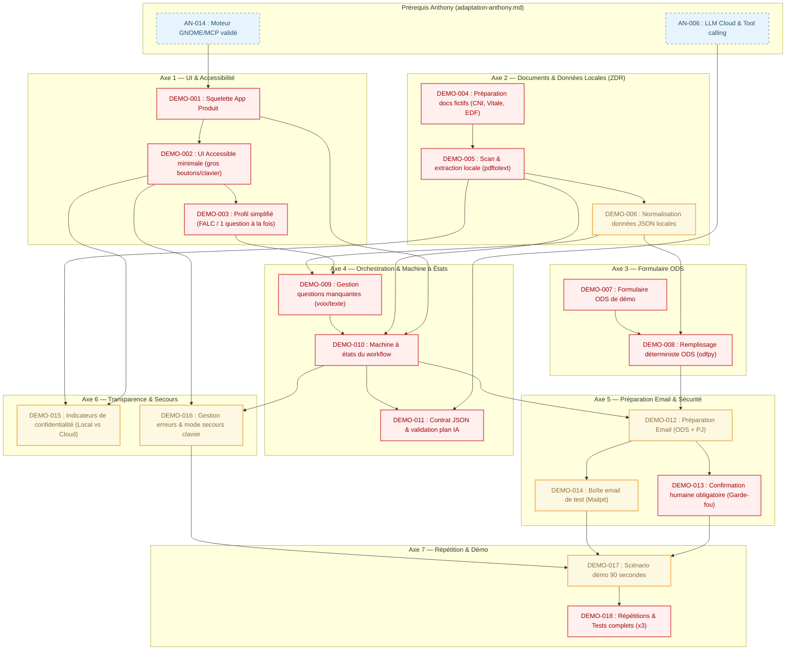

# Démo — Tickets du produit d'accessibilité

Ce document concerne la valeur ajoutée de notre produit au-dessus d'Anthony : profils d'accessibilité, guidage, documents, formulaire `.ods`, email et sécurité.

## Objectif de la démo

Présenter en moins de 90 secondes un parcours complet :

```text
Demande vocale
    → lecture de documents locaux
    → questions manquantes
    → remplissage d'un formulaire ODS
    → préparation d'un email
    → confirmation humaine
    → envoi vers une boîte de test
```

## Scénario utilisateur

L'utilisateur dit :

> « Remplis le formulaire avec ma CNI et ma carte Vitale. Pose-moi les questions nécessaires, puis envoie-le par email. »

L'application doit :

1. expliquer ce qu'elle a compris ;
2. lire les documents de démonstration localement ;
3. poser une question à la fois pour les champs manquants ;
4. remplir le formulaire `.ods` ;
5. préparer l'email et les pièces jointes ;
6. montrer un récapitulatif ;
7. attendre une confirmation explicite ;
8. envoyer vers une boîte email de test ;
9. annoncer clairement le résultat.

## Contraintes de la démo

- utiliser uniquement des documents fictifs ;
- ajouter le filigrane `DOCUMENT FICTIF — DÉMONSTRATION` ;
- ne jamais utiliser une vraie CNI ou une vraie carte Vitale ;
- ne jamais stocker de clé email dans le dépôt ;
- conserver l'extraction des documents sur la machine ;
- utiliser une boîte de réception de test ou Mailpit/MailHog ;
- avoir un parcours clavier de secours ;
- ne jamais envoyer automatiquement sans confirmation.

## Stack produit recommandée

- Python ;
- interface HTML locale ou PySide6 ;
- `odfpy` ou LibreOffice UNO pour écrire le fichier `.ods` ;
- `pdftotext` pour les faux PDF textuels ;
- OCR uniquement en option ;
- client SMTP de test ou Mailpit ;
- backend `CloudAIBackend` fourni par l'adaptation d'Anthony ;
- outils MCP Anthony uniquement pour les actions de bureau nécessaires.

## DAG des dépendances des tickets



## Tickets

### DEMO-001 — Créer le squelette de l'application produit

- **Priorité :** Bloquante
- **Dépendances :** AN-014

Créer un point d'entrée distinct du code Anthony pour notre produit.

**Critères d'acceptation :**

- l'application peut être lancée indépendamment du mode conversation d'Anthony ;
- elle possède un état de workflow ;
- elle peut appeler le backend IA et les outils autorisés ;
- les erreurs sont affichées dans un format utilisateur.

### DEMO-002 — Créer l'interface accessible minimale

- **Priorité :** Bloquante
- **Dépendances :** DEMO-001

Créer une interface avec :

- gros bouton « Parler » ;
- champ texte de secours ;
- affichage de la demande transcrite ;
- statut de l'étape en cours ;
- texte de réponse en grand format ;
- boutons « Confirmer », « Annuler » et « Réessayer » ;
- contraste élevé.

**Critères d'acceptation :**

- l'intégralité du parcours est possible au clavier ;
- l'action courante est toujours visible ;
- l'utilisateur sait lorsqu'une donnée part vers le cloud ;
- aucun écran technique n'est nécessaire pendant la démo.

### DEMO-003 — Implémenter le profil d'accompagnement simplifié

- **Priorité :** Bloquante
- **Dépendances :** DEMO-002

Créer le profil MVP destiné aux personnes ayant des difficultés cognitives ou une faible confiance numérique.

Règles :

- une seule question à la fois ;
- phrases courtes ;
- mots simples ;
- pas de jargon administratif non expliqué ;
- résumé avant chaque action importante ;
- confirmation explicite avant l'envoi.

**Critères d'acceptation :**

- le profil modifie les prompts envoyés au modèle ;
- les messages affichés et lus sont courts ;
- les champs manquants sont demandés séparément ;
- une réponse ambiguë entraîne une demande de clarification.

### DEMO-004 — Préparer les documents fictifs

- **Priorité :** Bloquante
- **Dépendances :** aucune

Créer un dossier local de démonstration :

```text
demo_data/documents/
├── cni_demo.pdf
├── carte_vitale_demo.pdf
└── justificatif_domicile_demo.pdf
```

Les données doivent être entièrement fictives et clairement marquées.

**Critères d'acceptation :**

- chaque document contient des données cohérentes entre elles ;
- le filigrane de démonstration est visible ;
- aucun document réel n'est commité ;
- les fichiers sont ignorés s'ils sont générés localement et contiennent des données sensibles.

### DEMO-005 — Scanner les documents localement

- **Priorité :** Bloquante
- **Dépendances :** DEMO-004

Lister les documents disponibles et extraire localement leur texte.

**Critères d'acceptation :**

- les documents sont identifiés par type ;
- le texte est extrait avant l'appel au cloud ;
- le PDF complet n'est pas transmis au cloud par défaut ;
- les données extraites sont normalisées dans un objet structuré ;
- un document absent produit une erreur compréhensible.

### DEMO-006 — Normaliser les informations personnelles

- **Priorité :** Haute
- **Dépendances :** DEMO-005

Convertir les documents en données structurées locales :

```json
{
  "nom": "DUPONT",
  "prenom": "Marie",
  "date_naissance": "12/03/1985",
  "adresse": "12 rue des Lilas",
  "numero_securite_sociale": "..."
}
```

**Critères d'acceptation :**

- les champs sont associés à une source locale ;
- les valeurs sont validées avant utilisation ;
- les champs sensibles ne sont pas affichés dans les logs ;
- les données envoyées au cloud sont limitées aux besoins du workflow.

### DEMO-007 — Créer le formulaire `.ods` de démonstration

- **Priorité :** Bloquante
- **Dépendances :** aucune

Créer un formulaire simple avec des cellules ou noms de champs fixes :

| Champ | Identifiant prévu |
|---|---|
| Nom | `nom` |
| Prénom | `prenom` |
| Date de naissance | `date_naissance` |
| Adresse | `adresse` |
| Numéro de sécurité sociale | `numero_securite_sociale` |
| Email | `email` |

**Critères d'acceptation :**

- le formulaire est lisible dans LibreOffice ;
- chaque champ possède un identifiant stable ;
- une zone de statut ou de récapitulatif est présente ;
- le bouton d'envoi ne provoque pas d'envoi réel.

### DEMO-008 — Remplir le fichier ODS de manière déterministe

- **Priorité :** Bloquante
- **Dépendances :** DEMO-006, DEMO-007

Écrire directement les valeurs dans les cellules du fichier `.ods`. Ne pas demander au modèle de cliquer visuellement dans LibreOffice.

**Critères d'acceptation :**

- les valeurs sont écrites dans les bons champs ;
- le fichier de sortie est créé séparément du modèle ;
- les valeurs peuvent être relues après écriture ;
- une donnée manquante bloque le workflow au lieu d'être inventée.

### DEMO-009 — Gérer les questions manquantes

- **Priorité :** Bloquante
- **Dépendances :** DEMO-003, DEMO-006

Identifier les champs requis absents et poser les questions une par une.

Exemples :

- « Quelle adresse email dois-je utiliser ? »
- « Quel est votre numéro de téléphone ? »

**Critères d'acceptation :**

- aucune question inutile n'est posée ;
- une réponse est confirmée ou reformulée ;
- une réponse ambiguë est redemandée ;
- l'utilisateur peut annuler le parcours.

### DEMO-010 — Définir la machine à états du workflow

- **Priorité :** Bloquante
- **Dépendances :** DEMO-001, DEMO-005, DEMO-009

Implémenter les états suivants :

```text
IDLE
→ UNDERSTANDING_REQUEST
→ READING_DOCUMENTS
→ ASKING_MISSING_DATA
→ FILLING_FORM
→ PREPARING_EMAIL
→ WAITING_CONFIRMATION
→ SENDING
→ COMPLETED
```

États d'erreur :

```text
→ CANCELLED
→ FAILED
→ NEEDS_HELP
```

**Critères d'acceptation :**

- un état est visible dans l'interface ;
- une action interdite dans un état est refusée ;
- un workflow interrompu ne peut pas envoyer un email par erreur ;
- le workflow peut revenir à l'état précédent lorsque c'est sûr.

### DEMO-011 — Définir le contrat JSON du plan IA

- **Priorité :** Bloquante
- **Dépendances :** AN-006, DEMO-010

Limiter les actions du modèle à des types validés :

```text
read_documents
ask_question
fill_form
prepare_email
request_confirmation
send_email
cancel
```

**Critères d'acceptation :**

- le JSON est validé par un schéma ;
- les types inconnus sont refusés ;
- les valeurs de champs ne sont jamais exécutées directement comme du code ;
- `send_email` est impossible avant `request_confirmation`.

### DEMO-012 — Préparer l'email sans l'envoyer immédiatement

- **Priorité :** Haute
- **Dépendances :** DEMO-008, DEMO-010

Créer un email contenant :

- destinataire de test ;
- objet explicite ;
- message simple ;
- formulaire `.ods` rempli ;
- pièces jointes sélectionnées.

**Critères d'acceptation :**

- le destinataire est affiché ;
- la liste des pièces jointes est affichée ;
- le contenu peut être relu à l'écran et à la voix ;
- l'email est encore modifiable ou annulable avant confirmation.

### DEMO-013 — Ajouter la confirmation humaine obligatoire

- **Priorité :** Bloquante
- **Dépendances :** DEMO-012

Présenter un résumé avant l'envoi :

```text
Le formulaire est rempli.
Le destinataire est demo@example.test.
Les pièces jointes sont formulaire.ods et justificatif_domicile_demo.pdf.
Voulez-vous envoyer cet email ?
```

**Critères d'acceptation :**

- aucune commande cloud ne peut contourner la confirmation ;
- « Non » annule l'envoi ;
- une réponse ambiguë redemande confirmation ;
- l'utilisateur peut consulter les pièces jointes.

### DEMO-014 — Mettre en place une boîte email de test

- **Priorité :** Haute
- **Dépendances :** DEMO-012

Utiliser Mailpit, MailHog ou un SMTP de test local pour recevoir le message.

**Critères d'acceptation :**

- aucun email réel n'est nécessaire ;
- l'email reçu est visible pendant la présentation ;
- les pièces jointes sont bien présentes ;
- les identifiants ne sont pas stockés dans Git.

### DEMO-015 — Ajouter les états de confidentialité

- **Priorité :** Haute
- **Dépendances :** DEMO-005, DEMO-002

Afficher clairement :

- « Lecture locale du document » ;
- « Données envoyées au service cloud » ;
- « Capture d'écran envoyée » ;
- « Prêt à envoyer l'email ».

**Critères d'acceptation :**

- l'utilisateur sait ce qui reste local ;
- l'utilisateur sait quand le cloud est utilisé ;
- les données sensibles ne sont pas écrites dans les logs visibles.

### DEMO-016 — Gérer les erreurs et le mode de secours

- **Priorité :** Haute
- **Dépendances :** DEMO-002, DEMO-010

Prévoir les cas suivants :

- API cloud indisponible ;
- microphone absent ;
- document absent ou illisible ;
- formulaire impossible à écrire ;
- boîte email indisponible ;
- utilisateur qui annule.

**Critères d'acceptation :**

- aucune erreur ne provoque d'envoi partiel ;
- un message simple explique le problème ;
- la saisie clavier permet de continuer sans voix ;
- le workflow peut être redémarré proprement.

### DEMO-017 — Préparer le scénario de présentation

- **Priorité :** Haute
- **Dépendances :** DEMO-013, DEMO-014, DEMO-016

Écrire un script de présentation de 90 secondes :

1. présenter le profil utilisateur ;
2. dire la demande vocale ;
3. montrer les documents lus localement ;
4. répondre à une question manquante ;
5. montrer le formulaire rempli ;
6. montrer le récapitulatif email ;
7. confirmer l'envoi ;
8. montrer le message reçu dans Mailpit.

**Critères d'acceptation :**

- le scénario tient en moins de 90 secondes ;
- chaque étape a un message de secours ;
- les données et destinataires sont fictifs ;
- la démonstration peut être recommencée plusieurs fois.

### DEMO-018 — Tester la démo complète

- **Priorité :** Bloquante
- **Dépendances :** DEMO-017 et tous les tickets bloquants

Répéter le scénario complet au moins trois fois.

**Critères d'acceptation :**

- le formulaire est correctement rempli à chaque fois ;
- les questions sont posées dans le bon ordre ;
- aucune donnée fictive n'est inventée ;
- l'envoi nécessite toujours une confirmation ;
- le mail reçu contient les bonnes pièces jointes ;
- le mode clavier de secours fonctionne.

## Résultat attendu de cette partie

La partie produit est terminée lorsque l'utilisateur peut accomplir une démarche administrative complète avec un accompagnement simple, comprendre chaque étape, valider l'envoi et recevoir le résultat dans une boîte de test.

## Hors périmètre de cette démo

- vraies CNI, cartes Vitale ou données personnelles ;
- envoi vers de vraies administrations ;
- prise en charge de tous les formats de formulaire ;
- OCR général sur tous les documents ;
- écoute vocale continue ;
- support de tous les profils de handicap ;
- support de toutes les distributions Linux ;
- agent autonome sans confirmation.
